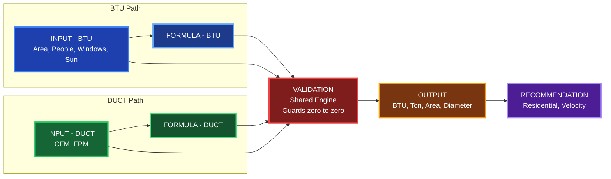

# ❄ HVAC Duct & BTU Calculator

A responsive, web-based engineering utility for preliminary HVAC calculations. Built with **Next.js (App Router)** and **TypeScript Strict**, it estimates cooling loads (BTU) and calculates optimal duct dimensions using the Continuity Equation and common duct-sizing practice.

**🌐 Live Demo:** https://hvac-calculator-ebon.vercel.app/

[[Playwright Tests](https://omar-khatab.github.io/HVAC-Calculator/lighthouse/)]
[[Lighthouse CI](https://omar-khatab.github.io/HVAC-Calculator/playwright/)]

[HVAC Cover](./assets/hvac-general-blocks.png)

## 🎬 Demo

### BTU Calculator - Live
[BTU Demo](./assets/hvac-btu-demo.gif)
*Area, People, Windows, Sun Exposure → BTU/h, Ton, HP, kW changes live*

### Duct Sizer - Live
[Duct Demo](./assets/hvac-duct-demo.gif)
*CFM / FPM → 4 optimal rectangular sizes sorted closest to square*

### 📸 Screenshots
| BTU Calculator | Duct Sizer |
| :---: | :---: |
| [BTU](./assets/btu-screenshot.png) | [Duct](./assets/duct-screenshot.png) |

---

## 🧩 General Block System - BTU & DUCT

Same block system powers both calculators:

[General Block System](./assets/hvac-general-blocks.png)



**Flow Logic:**
- **INPUT + FORMULA** → Both feed into **VALIDATION**
- **VALIDATION**: Shared engine - checks `velocity>0`, `cfm>0`, `area>0`, guards return `0` not `Infinity/NaN` for both BTU & Duct
- **OUTPUT** → **RECOMMENDATION**

### Detailed Flow per Calculator
[Detailed Block Flow](./assets/hvac-blocks.png)

---

## Reports

Both reports are regenerated by GitHub Actions on every push to `master` and published to GitHub Pages:

- 📊 [Lighthouse report](https://omar-khatab.github.io/HVAC-Calculator/lighthouse/) - performance, accessibility, best practices and SEO
- 🧪 [Playwright report](https://omar-khatab.github.io/HVAC-Calculator/playwright/) - end-to-end test results (28 tests on Chromium)

## Overview

This project digitizes manual HVAC field calculations into an interactive web interface. Originally inspired by ventilation analysis during an internship at the National Authority for Tunnels (NAT), it bridges mechanical engineering domain logic with modern frontend architecture.

The goal is a **testable, production-grade engineering tool** where formulas and manufacturing constraints are covered by unit tests, and the user flows are covered by end-to-end tests.

See [PLAN.md](PLAN.md) for the design plan: scope, architecture, testing strategy and known limitations.

## Key Features

### BTU Cooling Load Estimator
- Input-driven calculation based on area, occupancy, windows, and sun exposure
- Automatic conversions to Ton, HP, kW, and Watts
- Recommendation engine for residential and commercial spaces

### Duct Sizing Calculator
- Duct area via Continuity Equation: `A = Q / V`
- Equivalent round diameter: `D = 2 * sqrt(A / π)` (A in ft², D in ft; shown in inches)
- Rectangular sizes from standard widths (6"-48") with even-height rounding (manufacturing standard)
- Filters: max 10% area error, height 6"-48", aspect ratio ≤ 4:1 to prevent noise/friction
- Returns 4 optimal sizes sorted closest to square

### Velocity Status
- Low (quiet) / Medium (balanced) / High (noisy) indicators based on FPM

## Tech Stack

- **Framework:** Next.js App Router, React - `src/` directory structure
- **Language:** TypeScript Strict
- **Styling:** Tailwind CSS, Lucide Icons
- **Unit Testing:** Vitest 1.6.1, @testing-library/react, jsdom, @vitest/coverage-v8
- **E2E Testing:** Playwright (TypeScript) with Monocart reporter
- **CI/CD:** GitHub Actions (Playwright + Lighthouse CI), GitHub Pages for reports, Vercel for hosting

## Testing & Coverage

### Unit Tests

Business logic lives in `src/app/libs/` and is isolated for testability. Overall coverage is low by design because page shells, Main components, and input forms are not unit-tested - only pure logic and output components are. Those UI parts are covered by the Playwright E2E tests instead.

#### Latest Local Coverage (v8)

| File | % Stmts | % Branch | % Funcs | % Lines |
| :--- | :--- | :--- | :--- | :--- |
| **All files** | 42.05 | 88.13 | 45.45 | 42.05 |
| `libs/ductSuggestions.ts` | **100** | 92.3 | **100** | **100** |
| `libs/formulas.ts` | **100** | **100** | **100** | **100** |
| `BTUCalculator/BTUComponents/Outputs.tsx` | **100** | **100** | **100** | **100** |
| `DuctSizer/DuctComponent/Outputs.tsx` | **100** | **100** | **100** | **100** |
| `BTUCalculator/BTUComponents/Main.tsx` | 0 | 0 | 0 | 0 |
| `DuctSizer/DuctComponent/Main.tsx` | 0 | 0 | 0 | 0 |
| `components/Inputs.tsx` | 0 | 0 | 0 | 0 |
| `components/ProModel.tsx` | 0 | 0 | 0 | 0 |

#### 1. `src/app/libs/formulas.ts`
Pure BTU and duct physics:
- `roomArea * 430` BTU, occupant `people * 600` added after sun factor
- `A = Q/V`, `D = 2*sqrt(A*144/π)`, conversions `ft²→in²`, `ft²→m²`
- Guards: `velocity=0` → `0` not `Infinity`, `cfm=0` → `0`

#### 2. `src/app/libs/ductSuggestions.ts`
- Validates every suggestion: `area=w*h`, `error ≤10%`, `6≤h≤48`, `ratio≤4`
- `it.each([0.5, 0.7, 1.25, 2.4, 5])` ft² - always 1-4 results
- No duplicates: `12x16` == `16x12`
- Sorted by `ratio` asc (closest to square first)
- Edge: `0` or negative → `[]`

#### 3. `Outputs.tsx` Components
- BTU: `12,720 BTU/h = 1.59 hp = 1.06 Ton = 3.73 kW`
- Duct: `1000 CFM / 800 FPM = 1.25 ft² = 180 in² → D=15.1in`
- Velocity bands tested with `it.each` boundaries: 900=LOW, 901=MEDIUM, 1499=MEDIUM, 1500=HIGH
- Guard: never renders `NaN`

### End-to-End Tests (Playwright)

28 tests in `e2e/`. In CI they run against a production build (`npm run start` after `next build`); locally Playwright starts `npm run dev` or reuses a server already running on port 3000.

| Spec | Covers |
| :--- | :--- |
| `btu-calculator.spec.ts` | Default values, area changes, slider sync, complex scenario with formula check, validation, recommendation boundaries (11,400 / 12,000 / 18,000 BTU) |
| `duct-sizer.spec.ts` | Default values, CFM and velocity changes, velocity status (900 / 950 / 1500 FPM), validation, suggested rectangular sizes |
| `navigation.spec.ts` | Page navigation, logo redirect, mobile burger menu |
| `pro-modal.spec.ts` | "Get Pro" modal: open, close via button / overlay / Escape, click inside card, mobile flow |

### Running Tests

```bash
# Install
npm install --legacy-peer-deps

# Unit tests (single run, then with coverage)
npx vitest run
npx vitest run --coverage
npx vitest run src/app/libs/ductSuggestions.test.ts

# E2E tests (locally: starts the dev server, or reuses a running one)
npx playwright install chromium
npx playwright test --project=chromium
```

## Continuous Integration

| Workflow | Trigger | What it does |
| :--- | :--- | :--- |
| `playwright.yml` | push / pull request | Builds the app, runs the E2E suite on Chromium, uploads the report as an artifact, publishes it to GitHub Pages (`master` only) |
| `lighthouse.yml` | push | Builds the app, runs Lighthouse CI, publishes the report to GitHub Pages (`master` only) |

## Formulas

```
BTU Load = (Area * 430 + Windows * 1000) * SunFactor + People * 600
Duct Area (ft²) = CFM / FPM
Diameter (in) = 2 * sqrt( (Area(ft²) * 144) / pi )
```

## Project Structure

```
hvac-calculator/
├── .github/
│   └── workflows/
│       ├── lighthouse.yml
│       └── playwright.yml
├── .vscode/
│   └── extensions.json
├── .assets/
│   └── btu-screenshot.png
│   └── duct-screenshot.png
│   └── hvac-blocks.png
│   └── hvac-btu-demo.gif
│   └── hvac-combined.png
│   └── hvac-duct-demo.gif
│   └── hvac-general-blocks.png
├── e2e/
│   ├── pages/
│   │   └── calculators.page.ts
│   ├── btu-calculator.spec.ts
│   ├── duct-sizer.spec.ts
│   ├── navigation.spec.ts
│   └── pro-modal.spec.ts
├── public/
│   ├── Logo.svg
│   └── coverage.png
├── src/
│   ├── app/
│   │   ├── BTUCalculator/
│   │   │   ├── BTUComponents/
│   │   │   │   ├── Main.tsx
│   │   │   │   ├── Outputs.test.tsx
│   │   │   │   ├── Outputs.tsx
│   │   │   │   └── Recommendations.tsx
│   │   │   └── page.tsx
│   │   ├── DuctSizer/
│   │   │   ├── DuctComponent/
│   │   │   │   ├── Main.tsx
│   │   │   │   ├── Outputs.test.tsx
│   │   │   │   ├── Outputs.tsx
│   │   │   │   └── Recommendations.tsx
│   │   │   └── page.tsx
│   │   ├── components/
│   │   │   ├── Footer.tsx
│   │   │   ├── Inputs.tsx
│   │   │   ├── NavBar.tsx
│   │   │   └── ProModel.tsx
│   │   ├── libs/
│   │   │   ├── ductSuggestions.test.ts
│   │   │   ├── ductSuggestions.ts
│   │   │   ├── formulas.test.ts
│   │   │   ├── formulas.ts
│   │   │   └── types.ts
│   │   ├── globals.css
│   │   ├── icon.svg
│   │   ├── layout.tsx
│   │   └── page.tsx
│   └── setup.ts
├── .gitignore
├── LICENSE
├── PLAN.md
├── README.md
├── eslint.config.mjs
├── lighthouse.json
├── next.config.ts
├── package-lock.json
├── package.json
├── playwright.config.ts
├── postcss.config.mjs
├── tsconfig.json
└── vitest.config.ts
```

## Getting Started

```bash
git clone https://github.com/omar-khatab/HVAC-Calculator.git
cd HVAC-Calculator
npm install --legacy-peer-deps
npm run dev
# http://localhost:3000
```
