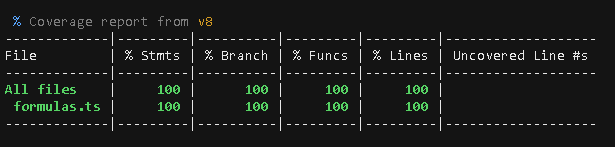

# ❄ HVAC Duct & BTU Calculator

A responsive, web-based engineering utility designed to streamline preliminary HVAC calculations. Built with **Next.js (App Router)** and **TypeScript**, this tool enables users to estimate cooling loads (BTU) and calculate optimal duct dimensions using real-world fluid dynamics and SMACNA standards.


**Live Demo:** https://hvac-calculator-ebon.vercel.app/

---

## 💡 Overview

This project bridges mechanical engineering domain knowledge with modern web development. Inspired by practical training at the **National Authority for Tunnels (NAT)** — analyzing subway station ventilation and HVAC infrastructure — this calculator digitizes manual field formulas into an interactive digital interface.

> **Built by Omar Khatab — Mechanical Power Engineer & Frontend Developer**
> Ain Shams University (2026) | NAT Intern - HVAC & Ventilation Systems

## ✨ Key Features

### 🔥 BTU Cooling Load Estimator
- Calculates cooling capacity based on area, occupants, windows, and sun exposure
- Auto-converts results to Ton / HP / kW
- Smart recommendation system for residential & commercial spaces

### 📐 Duct Sizing Calculator
- Computes duct area using **Continuity Equation** `A = Q / V`
- Suggests 4 optimal rectangular sizes sorted by aspect ratio (closest to square = best)
- Calculates equivalent round diameter
- Velocity-based status: Low (quiet) / Medium (balanced) / High (noisy)

### 🔍 Transparent Calculations
- Shows full formula breakdown with live values (Show Your Work)
- No black-box results - every number is traceable

## 🧪 Testing & Coverage

Business logic is isolated in `src/app/libs/formulas.ts` for 100% unit testability. No UI coupling.

**Coverage Report (v8):**



**100% on Stmts, Branch, Funcs, Lines**

**Strategy:**
- `toBe` for integer logic: `roomArea * 430 = 8600`
- `toBeCloseTo` for floating conversions: `ft2 -> cm2`
- **Edge cases covered:** `velocity=0` returns 0 not Infinity, `cfm=0`, empty inputs
- **Linearity check:** doubling CFM doubles area
- **Occupant logic:** heat load `people * 600` validated to be added AFTER sun exposure multiplication

Run tests:

```bash
npm run test
npx vitest --coverage